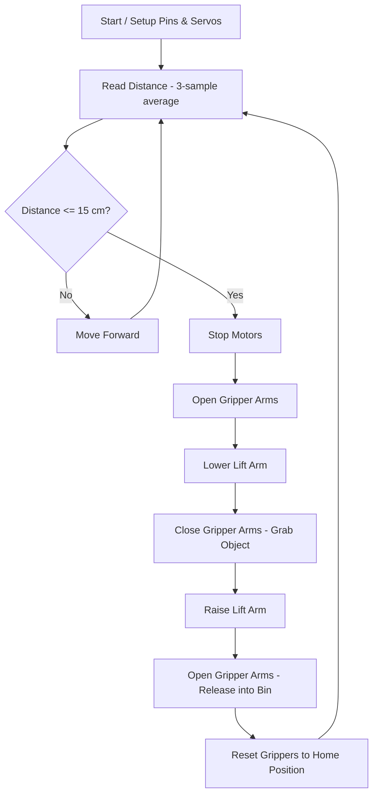

# 🤖 EcoBot — Solar-Powered Autonomous Garbage Collector

An Arduino-based autonomous mobile robot that detects nearby garbage using ultrasonic sensing, picks it up with a servo-driven gripper and lift arm, and deposits it into an onboard collection bin — built as a low-cost prototype for automated waste collection.


---

## 📌 Overview

EcoBot continuously drives forward while scanning the space ahead with an ultrasonic sensor. When an object (garbage) is detected within range, it stops, runs a multi-step gripper-and-lift sequence to pick the object up, and drops it into the bin mounted on top — then resumes patrolling. The design is intended to be extended with a solar charging circuit for continuous, self-sustained outdoor operation.

## ✨ Features

- **Autonomous navigation** — drives forward by default, no manual control needed
- **Obstacle/waste detection** — HC-SR04 ultrasonic sensor with 3-sample averaging to filter noise
- **Automated pickup sequence** — dual gripper arms + a lifting arm, all servo-driven with smooth step motion
- **Safe sensor handling** — `pulseIn()` timeout prevents the robot from freezing if no echo returns
- **Modular, readable firmware** — motor control, sensing, and servo motion are separated into clear functions
- **Low-cost build** — Arduino Uno, L298N motor driver, breadboard, SG90-class servos, 9V + AA battery packs

## 🧰 Hardware Used

| Component | Role |
|---|---|
| Arduino Uno | Main controller running the firmware |
| L298N Motor Driver | Drives the two DC drive motors |
| 2x DC Geared Motors + Wheels | Chassis drive |
| HC-SR04 Ultrasonic Sensor | Distance sensing for garbage/obstacle detection |
| 3x Micro Servo Motors (SG90-class) | Left gripper arm, right gripper arm, middle lift arm |
| Breadboard + jumper wires | Circuit prototyping |
| 9V battery + AA battery pack | Power supply (electronics + motors) |
| Plywood chassis + bin | Robot body and waste collection container |
| *(Planned)* Solar panel + charging module | Self-sustaining power for outdoor use |

## 🔌 Pin Configuration

| Function | Arduino Pin |
|---|---|
| Left Motor Forward | 2 |
| Left Motor Reverse | 3 |
| Right Motor Forward | 4 |
| Right Motor Reverse | 5 |
| Ultrasonic Trigger (TRIG) | 6 |
| Ultrasonic Echo (ECHO) | 7 |
| Left Gripper Servo | 8 |
| Right Gripper Servo | 9 |
| Middle Lift Servo | 10 |

## ⚙️ How It Works

1. The robot drives forward continuously via the L298N motor driver.
2. The HC-SR04 sensor is read 3 times per cycle and averaged (`getFilteredDistance()`) to smooth out noisy readings.
3. If the averaged distance is **≤ 15 cm**, the robot stops and runs `executeCollectionRoutine()`:
   - Gripper arms open
   - Lift arm lowers toward the ground
   - Gripper arms close around the object
   - Lift arm raises the object up toward the bin
   - Gripper arms open again to release the object into the bin
   - Gripper arms reset to the closed "home" position
4. If nothing is within range, the robot keeps moving forward.
5. The cycle repeats continuously (`loop()`), with live distance readings printed to Serial for debugging.

### Flowchart



## 🧪 Firmware

The full Arduino sketch is in [`EcoBot.ino`](./EcoBot.ino).

Key logic snippet — the detection-and-collection decision in `loop()`:

```cpp
void loop() {
  long distance = getFilteredDistance();
  Serial.print("Distance: ");
  Serial.print(distance);
  Serial.println(" cm");

  if (distance > 0 && distance <= DETECTION_DISTANCE_CM) {
    executeCollectionRoutine();
  } else {
    moveForward();
  }

  delay(60);
}
```

## 🚀 Getting Started

1. Wire the components according to the [pin configuration](#-pin-configuration) above.
2. Open `EcoBot.ino` in the Arduino IDE.
3. Install the built-in `Servo` library (bundled with the Arduino IDE by default).
4. Select your board (Arduino Uno) and COM port, then upload the sketch.
5. Open the Serial Monitor at **9600 baud** to watch live distance readings.
6. Power the robot and place it on a flat surface with test objects within ~15 cm to see the pickup routine trigger.

## 🔧 Tuning

| Constant | Purpose | Default |
|---|---|---|
| `DETECTION_DISTANCE_CM` | Trigger distance for pickup | 15 cm |
| `SERVO_STEP_DELAY_MS` | Speed of arm sweep (lower = faster) | 12 ms |
| `ARM_OPEN_ANGLE` / `ARM_CLOSED_ANGLE` | Gripper open/close range | 90° / 0° |
| `LIFT_UP_ANGLE` / `LIFT_DOWN_ANGLE` | Lift arm travel range | 0° / 100° |

## 🌱 Future Improvements

- Integrate a solar panel + charge controller for continuous autonomous operation
- Add obstacle avoidance / path planning instead of straight-line patrolling
- Add a bin-full sensor to pause collection and signal for emptying
- Swap ultrasonic for a wider-FOV sensor or camera for more reliable waste detection
- Add Bluetooth/WiFi telemetry for remote monitoring

## 📸 Gallery


## 📄 License

This project is open-sourced for educational and personal use. Feel free to fork, build on it, and improve it.

## 👤 Author

**Shivanand**
Final-year B.Tech CSE student, VIT Bhopal
